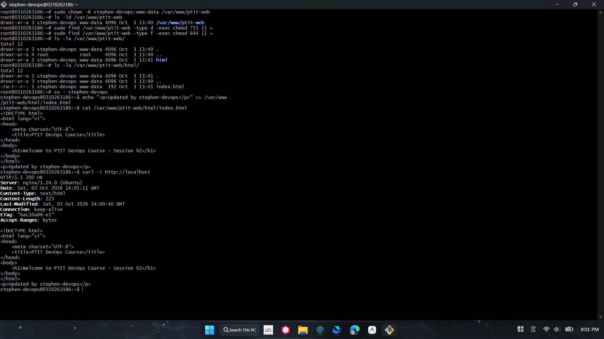

# BÀI TẬP 5: QUẢN LÝ QUYỀN SỞ HỮU THƯ MỤC WEB (DIRECTORY PERMISSION MANAGEMENT)

**Mã bài tập:** SESSION 02 - EXERCISE 5 (ss02-ex5)  
**Môn học:** IT215 - Cloud Infrastructure & DevOps Fundamentals  
**Máy chủ triển khai:** Ubuntu Server 24.04 LTS (`160.30.160.103`)  
**Thư mục cấu hình:** `/var/www/ptit-web/`  
**User:** `stephen-devops` | **Group:** `www-data`  

---

## 1. MỤC TIÊU

- Chuyển quyền sở hữu thư mục web `/var/www/ptit-web/` từ `root` sang user thường `stephen-devops` để có thể chỉnh sửa mã nguồn trực tiếp mà không cần dùng `sudo`.
- Đặt nhóm sở hữu là `www-data` (nhóm thực thi của Web Server Nginx) với quyền đọc để phục vụ website tĩnh bình thường, không gặp lỗi `403 Forbidden`.
- Thiết lập phân quyền chuẩn Linux: Thư mục `755` (`drwxr-xr-x`) và tệp tin `644` (`-rw-r--r--`).
- Kiểm tra chỉnh sửa file `index.html` bằng user thường và xác thực Nginx phản hồi mã `200 OK`.

---

## 2. CÁC BƯỚC TRIỂN KHAI TRÊN MÁY CHỦ

### Bước 1: Thay đổi chủ sở hữu và nhóm sở hữu
Chuyển quyền sở hữu đệ quy toàn bộ thư mục `/var/www/ptit-web` cho user `stephen-devops` và nhóm `www-data`:
```bash
sudo chown -R stephen-devops:www-data /var/www/ptit-web
```

### Bước 2: Thiết lập phân quyền thư mục và tệp tin
Phân quyền đệ quy: Thư mục `755` (để có quyền duyệt thư mục) và tệp tin `644` (chủ sở hữu đọc/ghi, nhóm đọc):
```bash
sudo find /var/www/ptit-web -type d -exec chmod 755 {} +
sudo find /var/www/ptit-web -type f -exec chmod 644 {} +
```

### Bước 3: Kiểm tra phân quyền thư mục
```bash
ls -ld /var/www/ptit-web
ls -la /var/www/ptit-web/
ls -la /var/www/ptit-web/html/
```

---

## 3. KIỂM TRA CHỈNH SỬA VÀ TRUY CẬP WEB

### 1. Chuyển sang user thường và ghi file không dùng `sudo`
```bash
su - stephen-devops
echo "<p>Updated by stephen-devops</p>" >> /var/www/ptit-web/html/index.html
cat /var/www/ptit-web/html/index.html
```
$\rightarrow$ Ghi file thành công không cần quyền root/sudo.

### 2. Kiểm tra phản hồi của Nginx
```bash
curl -i http://localhost
```
$\rightarrow$ Trả về mã trạng thái `HTTP/1.1 200 OK` kèm nội dung vừa cập nhật, không bị lỗi `403 Forbidden`.

---

## 4. HÌNH ẢNH MINH CHỨNG & LOG TERMINAL

### Hình ảnh minh chứng: Phân quyền thư mục và kiểm tra ghi file



---

### Log Terminal thực tế từ máy chủ:

```text
root@0310263186:~# sudo chown -R stephen-devops:www-data /var/www/ptit-web
root@0310263186:~# ls -ld /var/www/ptit-web
drwxr-xr-x 3 stephen-devops www-data 4096 Oct  3 13:40 /var/www/ptit-web

root@0310263186:~# sudo find /var/www/ptit-web -type d -exec chmod 755 {} +
root@0310263186:~# sudo find /var/www/ptit-web -type f -exec chmod 644 {} +

root@0310263186:~# ls -la /var/www/ptit-web/
total 12
drwxr-xr-x 3 stephen-devops www-data 4096 Oct  3 13:40 .
drwxr-xr-x 4 root           root     4096 Oct  3 13:40 ..
drwxr-xr-x 2 stephen-devops www-data 4096 Oct  3 13:41 html

root@0310263186:~# ls -la /var/www/ptit-web/html/
total 12
drwxr-xr-x 2 stephen-devops www-data 4096 Oct  3 13:41 .
drwxr-xr-x 3 stephen-devops www-data 4096 Oct  3 13:40 ..
-rw-r--r-- 1 stephen-devops www-data  192 Oct  3 13:41 index.html

root@0310263186:~# su - stephen-devops
stephen-devops@0310263186:~$ echo "<p>Updated by stephen-devops</p>" >> /var/www/ptit-web/html/index.html
stephen-devops@0310263186:~$ cat /var/www/ptit-web/html/index.html
<!DOCTYPE html>
<html lang="vi">
<head>
    <meta charset="UTF-8">
    <title>PTIT DevOps Course</title>
</head>
<body>
    <h1>Welcome to PTIT DevOps Course - Session 02</h1>
</body>
</html>
<p>Updated by stephen-devops</p>

stephen-devops@0310263186:~$ curl -i http://localhost
HTTP/1.1 200 OK
Server: nginx/1.24.0 (Ubuntu)
Date: Sat, 03 Oct 2026 14:01:11 GMT
Content-Type: text/html
Content-Length: 225
Last-Modified: Sat, 03 Oct 2026 14:00:40 GMT
Connection: keep-alive
ETag: "6ac10a88-e1"
Accept-Ranges: bytes

<!DOCTYPE html>
<html lang="vi">
<head>
    <meta charset="UTF-8">
    <title>PTIT DevOps Course</title>
</head>
<body>
    <h1>Welcome to PTIT DevOps Course - Session 02</h1>
</body>
</html>
<p>Updated by stephen-devops</p>
stephen-devops@0310263186:~$ 
```

---

## 5. KẾT LUẬN

- Hoàn thành thay đổi quyền sở hữu sang `stephen-devops:www-data` cho toàn bộ thư mục `/var/www/ptit-web`.
- Thiết lập quyền `chmod` chuẩn xác: Thư mục `755` và tệp tin `644`.
- User thường có thể chỉnh sửa tệp tin `index.html` trực tiếp mà không cần dùng `sudo`.
- Dịch vụ Web Nginx truy cập và phục vụ nội dung mới bình thường với mã `200 OK`.
